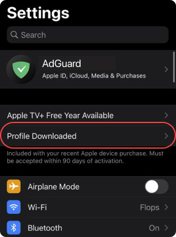
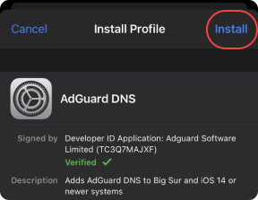

# TFLIX on iPhone, iPad & Mac

There's **no native Apple app**. Instead, the TFLIX website is added to the **Home Screen**
(iPhone and iPad) or the **Dock** (Mac), and then it opens in its own window, like an app:
no Safari tabs or address bar, with the TFLIX icon and name.

Because it's the live website, it's **always up to date**, with nothing to install or update.
But unlike the [desktop](../desktop/README.md) and [Android](../android/README.md) apps,
it **doesn't block the servers' ads**, so Get Apps marks it **Might Have Ads** and recommends
blocking them yourself (see [Block the ads](#block-the-ads)).

The same steps are on the site: **Get Apps → iPhone, iPad & Mac → How to Add** in the
profile menu.

## Add TFLIX

### iPhone and iPad

1. Open **tflix.stream** in Safari.
2. Tap **Share**. On iOS 26, tap **•••** first. It's at the bottom on iPhone and at the top on iPad.
3. Tap **Add to Home Screen**. If you don't see it, scroll down or tap **View More**.
4. If you see **Open as Web App**, make sure it's on. Then tap **Add**, and TFLIX shows up on your
   Home Screen.

On versions before iOS 26 there's no **Open as Web App** switch, but TFLIX still opens like an
app from the Home Screen, because the pages ask for it (see [How the site supports it](#how-the-site-supports-it)).

### Mac

1. Open **tflix.stream** in Safari (macOS Sonoma or later).
2. Choose **File → Add to Dock**, then click **Add**.

## Block the ads

The streaming servers show ads, pop-ups and redirects, and Safari doesn't block them on its own.

### iPhone and iPad: AdGuard DNS

AdGuard DNS is free, and it blocks ads, pop-ups and redirects on the whole device, not only in
TFLIX. It won't catch every single ad, but it stops most of them. It's a configuration profile
made and signed by AdGuard, and the site serves a copy of it
([how it's kept up to date](#the-adguard-dns-profile)).

1. In Safari, tap **Download AdGuard DNS** in Get Apps (or open
   <https://tflix.stream/assets/adguard/adguard-dns.mobileconfig>), then tap **Allow**.
2. Open the **Settings** app.
3. Tap **Profile Downloaded**, near the top.

   

4. Tap **Install** and follow the steps on screen.

   

5. If it isn't on by itself, go to **Settings → General → VPN & Device Management → DNS** and
   choose **AdGuard DNS**.

To remove it, go to **Settings → General → VPN & Device Management**, tap the AdGuard DNS profile
and choose **Remove Profile**.

Screenshots: [AdGuard](https://adguard-dns.io/en/public-dns.html).

### Mac: an ad blocker for Safari

Get one from the Mac App Store, such as **AdGuard for Safari** or **uBlock Origin Lite**, and turn
it on in **Safari → Settings → Extensions**. On macOS Sequoia or later it also works in TFLIX in
the Dock (check **TFLIX → Settings → Extensions**).

AdGuard DNS works on a Mac too, but it filters every app on the computer.
[Set it up on AdGuard's site](https://adguard-dns.io/en/public-dns.html).

## Good to know

- TFLIX on the Home Screen or Dock keeps its own data, apart from Safari. Sign in, or create a
  free account, to keep **My List** and **Continue Watching** in sync.
- There's nothing to update: it always opens the latest TFLIX.

## How the site supports it

There's no Apple code in this folder: the web app is the website itself. What makes it work
well from the Home Screen is in the `<head>` of [index.html](../../index.html),
[stream/index.html](../../stream/index.html) and [404.html](../../404.html):

| Tag | What it does |
| --- | --- |
| `<link rel="apple-touch-icon">` | The Home Screen and Dock icon ([assets/icons/apple-touch-icon.png](../../assets/icons/apple-touch-icon.png)) |
| `apple-mobile-web-app-title` | The name under the icon: **TFLIX** |
| `apple-mobile-web-app-capable` | Opens it like an app, without Safari's bars, including on iOS before 26 |
| `apple-mobile-web-app-status-bar-style` | A black status bar, to match the site |

All three pages need them, because a web app can be added from any of them.

## The AdGuard DNS profile

[assets/adguard/adguard-dns.mobileconfig](../../assets/adguard/adguard-dns.mobileconfig) is
AdGuard's own profile (AdGuard DNS, default ad-blocking servers, DNS-over-HTTPS), signed by
AdGuard. The site serves it so it downloads straight from Get Apps.

**Why it needs refreshing:** the certificate AdGuard signs it with expires. A profile signed
with an expired certificate still installs, but iOS shows it as **Not Verified**, which looks
untrustworthy. So the deployed copy is replaced before that happens.

Both jobs are done by [.github/scripts/adguard_profile.py](../../.github/scripts/adguard_profile.py):

### On every deploy: `pick`

[Deploy Website](../../.github/workflows/deploy-website.yml) runs
`adguard_profile.py pick assets/adguard/adguard-dns.mobileconfig` before uploading the site. It
gathers up to three copies:

1. a fresh one from AdGuard's API,
2. the one live on tflix.stream,
3. the one in the repo,

and deploys the **valid** copy that **expires latest**. It never fails the deploy: if no copy is
valid, the repo's is deployed as it is, with a warning. The run's summary lists each copy and
its expiry date, and warns when the fresh one from AdGuard couldn't be used or the deployed
copy has already expired.

The repo copy is only a fallback, and it isn't updated by the workflow, so it can be older than
the live one. That's fine: the live copy is one of the three sources.

### Once a month: `check`

[AdGuard Profile Check](../../.github/workflows/adguard-profile-check.yml) runs on the 1st of
every month at 06:00 UTC (and can be run by hand from the Actions tab). It runs
`adguard_profile.py check`:

- **Live copy has 30 days or more left:** nothing to do.
- **Under 30 days left (or the live copy is missing or invalid), and AdGuard has one that
  expires later:** it starts Deploy Website, which picks up the new one.
- **AdGuard has no valid newer one:** the run **fails**, and GitHub emails about it.

If it fails, the live profile keeps working until it expires. Run **AdGuard Profile Check**
again by hand a few days later; once it passes, the new profile is live. Updating the repo copy
isn't needed.

### What "valid" means

A copy is only used when:

- its signature verifies, with an unbroken certificate chain (checked with `openssl smime -verify`
  against the system's CA bundle),
- it's signed by an **AdGuard** certificate,
- it's the AdGuard DNS DNS-over-HTTPS profile, for `https://dns.adguard-dns.com/dns-query`.

The expiry date isn't part of it: an expired copy is still valid, so it can be deployed when
it's the only one there is (it then installs as **Not Verified**).

### Run it locally

It needs Python 3 and `openssl`, and a CA bundle at `/etc/ssl/certs/ca-certificates.crt` or in
`SSL_CERT_FILE`, so it's easiest on Linux or WSL:

```sh
python3 .github/scripts/adguard_profile.py check
python3 .github/scripts/adguard_profile.py pick assets/adguard/adguard-dns.mobileconfig
```

`pick` overwrites the file it's given with the copy it chooses.

## Files

| Path | What it is |
| --- | --- |
| [index.html](../../index.html) | Get Apps → iPhone, iPad & Mac (`#auth-apple`), and the Apple tags in `<head>` |
| [assets/adguard/adguard-dns.mobileconfig](../../assets/adguard/adguard-dns.mobileconfig) | AdGuard DNS profile (fallback copy; the deploy picks the best one) |
| [assets/adguard/](../../assets/adguard/) | AdGuard's screenshots and the Settings icon used in the steps |
| [.github/scripts/adguard_profile.py](../../.github/scripts/adguard_profile.py) | Picks and checks the AdGuard DNS profile |
| [.github/workflows/deploy-website.yml](../../.github/workflows/deploy-website.yml) | Deploys the site, with the profile from `pick` |
| [.github/workflows/adguard-profile-check.yml](../../.github/workflows/adguard-profile-check.yml) | The monthly `check` |
